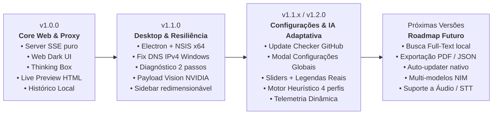

# ⚡ CLAUTRON OneClick — Relatório Completo de Evolução & Roadmap de Versões

**Autor:** Felipe Monroe  
**Repositório:** [felipeptxa/clautron](https://github.com/felipeptxa/clautron)  
**Licença:** MIT  
**Modelo Principal:** NVIDIA Nemotron 3.5 Super VL 120B (`nvidia/nemotron-3.5-super-vl-120b-a12b`)  
**Data do Relatório:** 05 de Novembro de 2026  

---

## Executive Summary

O **CLAUTRON OneClick** nasceu com o objetivo de oferecer uma estação desktop de alta performance para o modelo multimodal com raciocínio profundo da NVIDIA (**Nemotron 3.5 Super VL 120B**), sem requerer configurações complexas de ambiente Python, compilação de bibliotecas ou dependências locais pesadas de IA.

Através de uma arquitetura leve baseada em **Node.js nativo (zero dependências no backend)** e **Electron**, o software oferece streaming em tempo real via Server-Sent Events (SSE), suporte a visão computacional, sandbox de execução de código (Live Preview), inspeção de pensamento (Chain-of-Thought), central de hiperparâmetros e um motor heurístico adaptativo local.

---

## 🗺️ Linha do Tempo e Visão Geral das Versões



---

## 📦 Detalhamento Técnico Versão por Versão

### 1. Versão 1.0.0 — Fundação do Core e Web UI Local

A primeira versão estabeleceu os alicerces de comunicação com a NVIDIA NIM e a experiência visual do usuário.

| Componente | Implementação | Finalidade / Benefício |
| :--- | :--- | :--- |
| **Proxy Local (`server.js`)** | Servidor HTTP nativo Node.js (`http`, `https`, `fs`, `path`) | Elimina dependência de Express ou frameworks pesados; inicialização instantânea e consumo mínimo de RAM. |
| **Streaming SSE** | Proxy bidirecional Server-Sent Events (`/api/messages`) | Transmissão de tokens e raciocínio em tempo real com baixa latência para o navegador. |
| **Chain-of-Thought (CoT)** | Parser de `<thought>` e campo nativo `reasoning_content` | Caixa colapsável `<details class="thinking-box">` destacando o raciocínio profundo da IA. |
| **Interface Dark Theme** | CSS moderno com paleta escura (`#131314`, `#18191a`, `#282a2c`) | Ergonomia visual prolongada inspirada no Claude/Antigravity, sem poluição de menus. |
| **Formatador de Markdown** | Integração via CDN de `marked.js` e `highlight.js` | Renderização rica de textos, tabelas, listas e blocos de código com destaque de sintaxe escuro. |
| **Live HTML Preview** | `iframe` com sandbox de isolamento e script de injeção | Permite testar e executar artefatos HTML, CSS e JavaScript gerados pela IA sem sair da aplicação. |
| **Histórico de Conversas** | Persistência local no navegador via `localStorage` (`nemotron_chat_sessions_v1`) | Múltiplas sessões independentes, renomeação de tópicos, exclusão e exportação individual para `.md`. |
| **Entrada de Anexos** | Suporte a arquivos de código e imagens via Drag-and-Drop e `Ctrl+V` | Inclusão de código fonte e captura de tela diretamente no prompt do usuário. |
| **Scripts de Inicialização** | `START CLAUTRON.bat` e `run.sh` | Permite ao usuário iniciar o app com um duplo clique no Windows ou Linux. |

---

### 2. Versão 1.1.0 — Desktop Nativo, Robustez de Rede e Diagnóstico

A versão 1.1 transformou a aplicação Web em um aplicativo desktop nativo para Windows e resolveu desafios de rede e compatibilidade com a API da NVIDIA.

#### 🔧 Principais Marcos Técnicos:
1. **Migração para Electron Desktop:**
   - Adicionados `main.js`, `electron@^40.8.0` e `electron-builder@^26.0.2`.
   - Criação do instalador executável `CLAUTRON OneClick Setup 1.1.0.exe` (NSIS x64).
   - Atalho de desenvolvedor **F12** integrado para depuração e inspeção do DOM.
   - Janela frameless customizada (título nativo, controle de tamanho mínimo e preservação de estado).

2. **Correções de Conectividade e Protocolo:**
   - **Fix IPv6 Dual-Stack no Windows:** Adicionado `dns.setDefaultResultOrder('ipv4first')` em `main.js` e `server.js`, eliminando congelamentos de DNS causados por interfaces IPv6 inativas.
   - **Fix do Streaming Abort Prematuro:** Substituição de `req.on('close')` por `res.on('close')` no proxy. O evento anterior disparava assim que o cliente terminava de enviar o corpo POST, cancelando a requisição à NVIDIA antes do primeiro token chegar.
   - **Padronização Multimodal NVIDIA:** Conversão do payload de imagens para o formato estrito `{ type: "image_url", image_url: { url: "data:...;base64,..." } }`, compatibilizando o upload de capturas com o padrão aceito pelo Nemotron Vision.

3. **Botão de Diagnóstico de 2 Passos no Cabeçalho (`/api/test-nvidia`):**
   - **Passo 1:** Validação da chave `nvapi-...` e conectividade contra `https://integrate.api.nvidia.com/v1/models` (timeout 15s).
   - **Passo 2:** Teste de inferência real de 1 token sem streaming (timeout 20s).
   - Indicadores visuais dinâmicos no cabeçalho: `Verificando...`, `NVIDIA OK ✓` ou mensagens precisas de erro (ex: HTTP 401 para chave inválida, HTTP 403 para permissão e 504 para timeout).

4. **Refinamentos de Interface:**
   - Barra lateral (`aside`) retrátil com suporte a redimensionamento manual arrastando a borda (drag-to-resize com limites seguros entre 180px e 520px).
   - Licença MIT formalizada e README bilíngue (Português e Inglês).

---

### 3. Versão 1.1.1 (Atual) — Clautron NeMo Core, Guardrails e LLM-as-a-Judge

Nesta etapa, o CLAUTRON recebeu inteligência heurística local, permitindo que a própria aplicação module seus hiperparâmetros de acordo com o contexto da conversa.

#### 🚀 Recursos Implementados:

#### A. Verificador Automático de Atualizações do GitHub
- Consulta assíncrona leve à API pública: `https://api.github.com/repos/felipeptxa/clautron/releases/latest`.
- Comparação semântica de versões (`1.1.0` vs tag mais recente).
- Badge animado pulsante no cabeçalho: `🟢 Atualização Disponível`.
- Modal de atualização com exibição do Changelog oficial formatado em Markdown e botão direto para download do release.
- Operação 100% silenciosa caso o usuário esteja offline ou a API atinja rate-limit.

#### B. Central de Configurações Globais (Engrenagem ⚙️)
- Transformação do antigo modal de chave em uma central completa dividida em 3 seções:
  1. **Chave API NVIDIA (`nvapi-...`):** Campo seguro com preservação no `localStorage`.
  2. **Custom System Prompt Permanente:** Textarea expansível para definir instruções de comportamento que persistem em todas as conversas.
  3. **Hiperparâmetros de Inferência com Sliders e Legenda em Tempo Real:**
     * **Temperature (0.0 a 1.5, step 0.05):** Feedback em tempo real:
       - *0.00 – 0.39:* "🎯 Respostas ultra determinísticas e precisas (ideal para código, lógica pura e refatoração)".
       - *0.40 – 0.89:* "⚖️ Equilíbrio padrão da indústria (respostas balanceadas e contextuais)".
       - *0.90 – 1.50:* "🎨 Mais criativo e exploratório (ideal para brainstorming, redação e conceitos visuais)".
     * **Top-P (0.1 a 1.0, step 0.05):** Filtro de amostragem por probabilidade cumulativa.
     * **Max Output Tokens (512 a 8192, step 256):** Orçamento máximo de resposta do modelo.
  4. **Botão "Restaurar Padrões":** Reseta os sliders para 0.70, 0.95 e 4096 com um clique.

#### C. Motor Heurístico Adaptativo ("🤖 Automático")
Um classificador local de intenção e complexidade analisa o prompt e anexos do usuário antes do envio (`detectPromptComplexity`), aplicando automaticamente o perfil ideal:

| Categoria | Critérios de Detecção | Temp | Top-P | Max Tokens | Thinking (CoT) | Tag / Telemetria |
| :--- | :--- | :---: | :---: | :---: | :---: | :--- |
| **Código / Técnico** | Blocos ```, arquivos de código (.js, .py, etc.), termos como `refatore`, `função`, `bug`, `api`, `sql` | **0.20** | **0.90** | **8192** | `true` | `Auto (Código)` |
| **Criativo / Brainstorm** | Palavras como `crie uma história`, `roteiro`, `brainstorm`, `slogan`, `poema`, `copy` | **1.05** | **0.98** | **4096** | `false` | `Auto (Criativo)` |
| **Rápido / Factual** | Texto curto (< 70 caracteres), sem código, saudações (`olá`, `bom dia`) e perguntas diretas (`o que é`, `defina`) | **0.30** | **0.85** | **1536** | `false` | `Auto (Rápido)` |
| **Profundo / Analítico** | Prompts longos (> 200 caracteres), comparações (`compare`, `analise`, `arquitetura`, `prós e contras`) | **0.60** | **0.95** | **6144** | `true` | `Auto (Profundo)` |

- **Feedback Visual no Modal:** Quando no modo Automático, os sliders ficam com opacidade suave (`.auto-mode`) e é exibido o card explicativo *"Parâmetros modulados automaticamente a cada pergunta"*. Se o usuário arrastar qualquer slider manualmente, o preset muda automaticamente para **"🛠️ Manual"**.
- **Telemetria de Rodapé:** Cada balão de resposta registra o perfil adotado: ex. `Effort: Auto (Código)`.
- **Suporte no Proxy (`server.js`):** Repassa `temperature`, `top_p`, `max_tokens` e a flag booleana `chat_template_kwargs: { enable_thinking: isThinking }` para a API NVIDIA.

---


#### D. Clautron NeMo Core & Guardrails de Segurança
Inspirado nas diretrizes do framework NVIDIA NeMo, o CLAUTRON v1.1.1 implementou uma camada nativa de integridade e segurança no proxy local (`server.js`):
1. **NeMo Guardrails de Pré-Validação (`applyNeMoGuardrails`):**
   - Sanitização de caracteres de controle e bytes nulos (`\0`).
   - Normalização e validação de histórico para garantir alternância estrita de papéis (`user` / `assistant`), prevenindo quebras de contexto na API da NVIDIA.
2. **Suporte a Hiperparâmetros Avançados:**
   - **Seed Determinística:** Parâmetro `seed` configurável nas opções para reprodução exata de respostas do modelo.
   - **Modo JSON Estrito:** Repasse de `response_format: { "type": "json_object" }` quando solicitado.

#### E. Motor NeMo LLM-as-a-Judge em Segundo Plano (`POST /api/nemo/evaluate`)
- Chamada assíncrona desacoplada da geração em streaming, avaliando em segundo plano:
  - *Accuracy* (precisão técnica e factual).
  - *Completeness* (abrangência da resposta).
  - *Conciseness* (clareza e ausência de prolixidade).
- Retorno estrito em JSON estruturado: `{ score: number, verdict: 'PASS' | 'FAIL', reasoning: string }`.
- Registro contínuo e persistente em `data/nemo_evals.jsonl`.

#### F. Telemetria Estruturada, Feedback & Acabamento de UI
1. **Logging JSONL Local:** Registro estruturado de cada conversa em `data/interactions.jsonl` com latência TTFT, tempo total, esforço e parâmetros.
2. **Botões de Avaliação Humana:** Botões 👍 (Útil) e 👎 (Reportar Problema) no rodapé de cada resposta, com registro imediato em `data/feedback.jsonl`.
3. **Badge Dinâmico NeMo:** Exibição do selo `🛡️ NeMo: Verificado` ou `🛡️ NeMo: PASS (9/10)` com o parecer do avaliador ao passar o mouse.
4. **Smart Auto-Scroll:** Desativa a rolagem forçada quando o usuário rola para cima, eliminando o efeito de travamento de tela ("scroll hijacking").
5. **Thinking Recolhido por Padrão:** O bloco de raciocínio da IA permanece fechado durante a geração e só expande com o clique deliberado do usuário.
6. **Busca Instantânea no Histórico:** Barra de pesquisa em tempo real na barra lateral para filtrar conversas por palavras-chave.
7. **Cronômetro TTFT:** Telemetria com Time to First Token e tempo total em segundos nos balões do assistente.

---

## 🏗️ Matriz Comparativa da Evolução

| Recurso | v1.0.0 | v1.1.0 | v1.1.1 (Atual) |
| :--- | :---: | :---: | :---: |
| **Ambiente de Execução** | Navegador Web | Desktop Electron (NSIS x64) | Desktop Electron + Web (v1.1.1) |
| **Modelo NIM** | Nemotron 3.5 Super VL | Nemotron 3.5 Super VL | Nemotron 3.5 Super VL |
| **Diagnóstico de Conexão** | ❌ Não | ✅ 2 Passos (Rede + Inferência) | ✅ 2 Passos com Feedback de Erro |
| **Suporte Multimodal** | Básico | ✅ Formato Estrito NVIDIA | ✅ Formato Estrito NVIDIA |
| **Sidebar Redimensionável** | ❌ Fixa | ✅ Drag-to-Resize | ✅ Drag-to-Resize |
| **Checagem de Atualização** | ❌ Não | ❌ Não | ✅ GitHub Releases API com Modal |
| **Custom System Prompt** | ❌ Não | ❌ Não | ✅ Permanente no LocalStorage |
| **Ajuste de Hiperparâmetros** | ❌ Fixo no proxy | ❌ Fixo no proxy | ✅ Sliders manuais + Legendas vivas |
| **Seleção de Esforço** | Manual (Low/Med/High) | Manual (Low/Med/High) | ✅ Modo Adaptativo Heurístico (4 perfis) |
| **Telemetria na Mensagem** | Estática | Estática | ✅ Dinâmica por Perfil + TTFT |
| **NeMo Guardrails** | ❌ Não | ❌ Não | ✅ Sanitização e Alternância Estrita |
| **NeMo LLM-as-a-Judge** | ❌ Não | ❌ Não | ✅ Avaliação Assíncrona em Background |
| **Logging JSONL (Eval)** | ❌ Não | ❌ Não | ✅ data/interactions.jsonl e nemo_evals |
| **Feedback Humano (👍/👎)** | ❌ Não | ❌ Não | ✅ Integrado com Categorização |
| **Smart Auto-Scroll** | ❌ Travado | ❌ Travado | ✅ Livre de Scroll Hijacking |
| **Busca no Histórico** | ❌ Não | ❌ Não | ✅ Filtro em Tempo Real na Sidebar |

---

## 🎯 Roadmap Estratégico para Próximas Versões

Com a base técnica estabilizada, este é o catálogo priorizado de implementações para as próximas versões:

### 🌟 Versão 1.2.0 (Foco: Produtividade, Busca & Exportação)
- [ ] **Busca Global no Histórico:** Barra de pesquisa em tempo real na barra lateral para localizar conversas antigas por palavras-chave ou trechos de código.
- [ ] **Exportação em Múltiplos Formatos:**
  - Exportar conversa completa em **PDF** formatado (com suporte a quebra de página limpa de código).
  - Exportar em **JSON estruturado** para backup e importação entre máquinas.
- [ ] **Importação de Sessões:** Permitir restaurar backups de histórico com um clique.
- [ ] **Limpeza de Contexto Inteligente:** Botão de "Limpar Histórico Desta Sessão" mantendo o System Prompt ativo sem precisar criar uma nova conversa.

### 🚀 Versão 1.3.0 (Foco: Multi-Modelos & Experiência Avançada)
- [ ] **Seletor de Modelos NVIDIA NIM:**
  - Permitir alternar entre `nemotron-3.5-super-vl-120b`, `llama-3.1-405b-instruct`, `deepseek-r1` ou outros modelos disponíveis na conta do usuário.
- [ ] **Calculadora de Consumo de Tokens:**
  - Exibir contador aproximado de tokens consumidos na sessão e tempo de resposta (tokens/segundo).
- [ ] **Atalhos de Teclado Globais (Keybindings):**
  - `Ctrl + N`: Nova conversa.
  - `Ctrl + K`: Abrir busca de conversas.
  - `Ctrl + ,`: Abrir Configurações.
  - `Ctrl + Shift + S`: Alternar exibição da barra lateral.

### 🛡️ Versão 1.4.0 (Foco: Atualização Silenciosa & Áudio)
- [ ] **Auto-Updater Integrado:** Integração com `electron-updater` para baixar e instalar atualizações em segundo plano sem exigir download manual do `.exe`.
- [ ] **Entrada de Voz (Speech-to-Text):** Integração com Whisper local ou via API para ditar prompts pelo microfone.
- [ ] **Modo Janela Flutuante (Picture-in-Picture / Always-on-Top):** Janela compacta fixada sobre outros programas para consultas rápidas enquanto programa.

---

> [!TIP]
> **Como Exportar Este Relatório:**
> Este documento pode ser exportado diretamente para Markdown (`.md`) ou impresso como PDF a partir do visualizador do seu ambiente. Ele serve como documentação de entrega da versão atual e base de especificação para as próximas issues e sprints do repositório.
