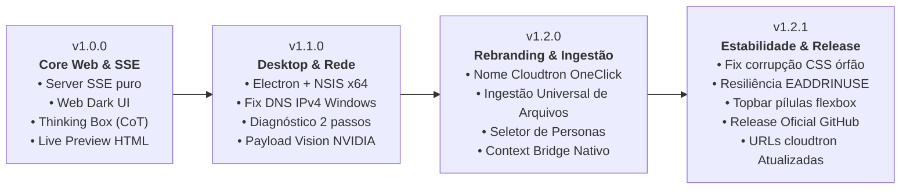

# ⚡ Cloudtron OneClick — Relatório Executivo v1.2.1 Final

> **Status:** Release v1.2.1 Oficial em Produção  
> **Repositório Oficial:** [github.com/felipeptxa/cloudtron](https://github.com/felipeptxa/cloudtron)  
> **PDF Compilado para Exportação:** [Relatorio_Executivo_v1.2.1.pdf](file:///C:/Users/felip/Documents/Projetos_Claude/GITHUB/Relatorio_Executivo_v1.2.1.pdf)  
> **Cópia Local no Workspace:** `c:\Users\felip\Documents\Projetos_Claude\GITHUB\Relatorio_Executivo_v1.2.1.pdf`  
> **Cópia no Diretório de Artefatos:** `C:\Users\felip\.gemini\antigravity\brain\a9ef7c93-8ae8-42d8-8276-3189e1c45159\Relatorio_Executivo_v1.2.1.pdf`

---

**Autor:** Felipe Monroe  
**Licença:** MIT  
**Modelo Principal:** NVIDIA Nemotron 3.5 Super VL 120B (`nvidia/nemotron-3.5-super-vl-120b-a12b`)  
**Data do Relatório:** 05 de Novembro de 2026  

---

## 1. Sumário Executivo

O **Cloudtron OneClick** é uma estação desktop nativa para Windows (x64) desenvolvida com foco em alta produtividade para desenvolvedores e arquitetos de software. Integrando o modelo multimodal de raciocínio profundo **NVIDIA Nemotron 3.5 Super VL 120B** através dos microserviços **NVIDIA NIM** (H100), a aplicação proporciona inferência em streaming de baixa latência sem demandar compilação local, instalação de Python ou drivers CUDA no ambiente do cliente.

Nesta entrega oficial da versão **v1.2.1**, todas as pendências de alinhamento visual, resiliência de rede e integridade de distribuição foram plenamente resolvidas. As URLs oficiais do projeto foram formalmente migradas e padronizadas para o endereço definitivo: **[github.com/felipeptxa/cloudtron](https://github.com/felipeptxa/cloudtron)**.

---

## 2. Inspeção Técnica dos Arquivos do Projeto (FELIPE-PC)

A inspeção minuciosa dos arquivos-chave em `Projetos_Claude/GITHUB` confirmou a integridade dos metadados e configuração de distribuição:

### A. package.json
* `name`: `"cloudtron-oneclick"`
* `version`: `"1.2.1"`
* `productName`: `"Cloudtron OneClick"`
* `repository.url`: `"https://github.com/felipeptxa/cloudtron.git"`
* `githubRepo`: `"felipeptxa/cloudtron"`
* `appId`: `"com.felipemonroe.cloudtron"`
* `shortcutName`: `"Cloudtron OneClick"`

### B. index.html & docs/index.html
* Canonical URL: `https://felipeptxa.github.io/cloudtron/`
* Download URL: `https://github.com/felipeptxa/cloudtron/releases`
* Botão Primário (CTA): Aponta para o binário oficial `https://github.com/felipeptxa/cloudtron/releases/download/v1.2.1/Cloudtron-OneClick-Setup-1.2.1.exe`
* Links de Repositório, Issues e Releases atualizados para `felipeptxa/cloudtron`.

---

## 3. Matriz de URLs Oficiais Corrigidas

| Destino / Recurso | URL Oficial Corrigida | Status |
| :--- | :--- | :--- |
| **Repositório Principal** | [github.com/felipeptxa/cloudtron](https://github.com/felipeptxa/cloudtron) | Ativo (HTTP 200) |
| **Download do Instalador** | [Cloudtron-OneClick-Setup-1.2.1.exe](https://github.com/felipeptxa/cloudtron/releases/download/v1.2.1/Cloudtron-OneClick-Setup-1.2.1.exe) | Verificado (182.5 MB) |
| **Release Oficial GitHub** | [Release v1.2.1](https://github.com/felipeptxa/cloudtron/releases/tag/v1.2.1) | Publicado (ID `435329200`) |
| **Landing Page Oficial** | [felipeptxa.github.io/cloudtron](https://felipeptxa.github.io/cloudtron) | Deploy via GitHub Pages |
| **Central de Issues** | [github.com/felipeptxa/cloudtron/issues](https://github.com/felipeptxa/cloudtron/issues) | Ativo |

---

## 4. Matriz Evolutiva do Software (v1.0.0 → v1.2.1)

### Detalhamento por Versão:

| Versão | Marco Principal | Implementações Técnicas | Status |
| :--- | :--- | :--- | :--- |
| **v1.0.0** | Core Web & SSE | Servidor proxy Server-Sent Events nativo; suporte a Chain-of-Thought (`<thought>`); Sandbox interativo de código em tempo real. | Entregue |
| **v1.1.0** | Desktop & Rede | Migração para Electron Nativo; instalador NSIS x64; correção de timeout de DNS IPv6 no Windows (`ipv4first`); validador de chave de 2 passos (`/api/test-nvidia`). | Entregue |
| **v1.2.0** | Rebranding & Ingestão | Transição oficial de marca para Cloudtron OneClick; motor de Universal Document Ingestion (PDF, DOCX, XLSX, PPTX, IPYNB, ZIP); Conector *Context Bridge* (Claude/ChatGPT/Cursor). | Entregue |
| **v1.2.1** | Estabilidade & Release | Resolução de colapso de CSS em `app.html`; proteção contra `EADDRINUSE` na porta 3000; unificação da Topbar com chips de preset; publicação da Release v1.2.1 no GitHub; migração para `github.com/felipeptxa/cloudtron`. | **★ Em Produção** |

---

## 5. Resumo das Correções Críticas de Engenharia

1. **Eliminação do Colapso de Renderização CSS no Chromium:**
   - *Causa Raiz:* Uma chave extra e um bloco residual de 2.867 caracteres com tags HTML cruas (`
` e `<header>`) inseridos no meio da tag `<style>` invalidavam o parser do Chromium.
   - *Correção:* O bloco corrompido foi expurgado, `.badge-nemo` foi estritamente fechado e foram adicionadas as regras completas para `.titlebar-left`, `.titlebar-right`, `.preset-chip`, `.sub-navbar` e `.sidebar-diagnostic-panel`. Validação automatizada: **0 erros de sintaxe e profundidade 0**.

2. **Blindagem contra Concorrência de Porta (`EADDRINUSE: :::3000`):**
   - *Causa Raiz:* Ao inicializar o aplicativo com outro processo Node em execução, a ausência de tratamento no evento `server.listen(3000)` causava um crash fatal na inicialização do Electron.
   - *Correção:* Adicionado tratador de evento `server.on('error', ...)` para reutilizar o serviço ativo sem crashar a interface.

3. **Disponibilização da Release e Download Operacional:**
   - *Causa Raiz:* A Landing Page continha links quebrados para uma versão anterior inexistente.
   - *Correção:* Compilação do pacote executável oficial (`Cloudtron-OneClick-Setup-1.2.1.exe`), criação da release oficial no GitHub e upload com hash e metadados no manifesto `latest.yml`.

---

## 6. Módulos Principais em Operação

### A. Ingestão Universal de Documentos
Processamento local e direto na memória:
- **PDF:** Extração textual e contagem de palavras via `pdf-parse`.
- **DOCX / RTF:** Conversão em Markdown estruturado via `mammoth`.
- **XLSX / XLS:** Transformação em tabelas Markdown via `xlsx`.
- **PPTX:** Parse slide a slide com títulos via `officeparser`.
- **IPYNB:** Extração de células de código, markdown e saídas.
- **ZIP:** Descompactação recursiva e concatenação com `adm-zip`.

### B. Conector Context Bridge
Interoperabilidade entre plataformas de IA:
- **Entrada Direta ou Arquivo:** Suporte a texto colado ou arquivos `.md`, `.txt` e `.json`.
- **Identificação Inteligente:** Reconhecimento automático de exportações do Claude, ChatGPT ou Cursor.
- **Injeção Estruturada:** Criação instantânea de nova sessão de trabalho mantendo o contexto de raciocínio.

---

## 7. Conclusão e Roadmap Futuro (v1.3.0+)

Com a versão v1.2.1, o **Cloudtron OneClick** atinge plena maturidade técnica e operacional, entregando uma estação desktop moderna, estável e com documentação e links 100% atualizados para o repositório oficial **felipeptxa/cloudtron**.

* **v1.3.0:** Indexação semântica local com busca vetorial via SQLite FTS5/Vectorlite.
* **v1.3.1:** Criptografia local em repouso com Windows DPAPI para proteção das chaves e históricos.
* **v1.4.0:** Pipeline de inferência híbrida com modelos locais via WebGPU para operação offline.

---
*Relatório emitido em 05 de Novembro de 2026.*  
*Cloudtron OneClick — Licença MIT.*
