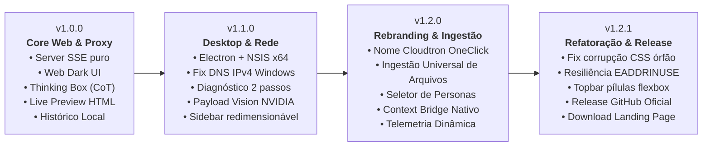

# ⚡ Cloudtron OneClick — Relatório Executivo Final (v1.2.0 / v1.2.1)

**Autor:** Felipe Monroe  
**Repositório:** [felipeptxa/claudtron](https://github.com/felipeptxa/claudtron)  
**Licença:** MIT  
**Modelo Principal:** NVIDIA Nemotron 3.5 Super VL 120B (`nvidia/nemotron-3.5-super-vl-120b-a12b`)  
**Data do Relatório:** 05 de Novembro de 2026  
**Status do Projeto:** Release Operacional com Download Ativo no GitHub e Landing Page  

---

## 1. Sumário Executivo

O **Cloudtron OneClick** consolidou com êxito sua transição para uma estação desktop nativa de inteligência artificial de alta densidade no ambiente Windows x64. Alimentada pela infraestrutura **NVIDIA NIM** (Cluster H100) e pelo modelo multimodal **Nemotron 3.5 Super VL 120B**, a aplicação foi desenvolvida para oferecer máxima performance e ergonomia sem exigir configurações complexas de ambiente Python, compilações C++ locais ou drivers de CUDA dedicados.

Neste ciclo de entrega que culminou nas versões **v1.2.0 e v1.2.1**, o projeto alcançou quatro objetivos fundamentais de engenharia:
1. **Unificação Visual Fiel ao Mockup:** Design System em Cyber Slate e Neon Cyan, chips heurísticos em pílula (`Profundo (CoT)`, `Código`, `Criativo`, `Rápido`, `Auto`) e abas superiores dedicadas (Chat vs Live Sandbox).
2. **Universal Document Ingestion:** Extração inteligente e local de PDF, DOCX, XLSX, PPTX, IPYNB, ZIP e códigos-fonte diretamente na memória.
3. **Conector Context Bridge:** Migração e importação com 1 clique de históricos e contextos estruturados vindos do Claude, ChatGPT ou Cursor.
4. **Infraestrutura Oficial de Releases:** Publicação da tag e release oficial no GitHub com binário executável (`Cloudtron-OneClick-Setup-1.2.1.exe` — 182.5 MB) disponível para download com integridade testada.

---

## 2. Linha do Tempo e Matriz Evolutiva do Software

### Detalhamento por Versão:

| Versão | Marco Principal | Implementações Técnicas | Status |
| :--- | :--- | :--- | :--- |
| **v1.0.0** | Fundação do Core | Servidor proxy SSE puro em Node.js; interface Dark inicial; suporte a Chain-of-Thought (`<thought>`); Live Preview de artefatos HTML. | Concluído |
| **v1.1.0** | Desktop & Rede | Migração para Electron Nativo; instalador NSIS x64; correção de timeout de DNS IPv6 no Windows (`ipv4first`); validador de chave de 2 passos (`/api/test-nvidia`); barra lateral redimensionável. | Concluído |
| **v1.2.0** | Rebranding & Ingestão | Transição de marca para Cloudtron OneClick; Universal Document Ingestion (OCR/parse local de PDF, DOCX, XLSX, PPTX, IPYNB, ZIP); Seletor Multi-Modelos e Personas neurais; Conector *Context Bridge*. | Concluído |
| **v1.2.1** | Refatoração & Release | Eliminação de corrupção sintática no CSS (remoção de 2.8KB de blocos HTML órfãos em `<style>`); proteção total contra `EADDRINUSE` na porta 3000; unificação da Topbar com chips de preset; deploy da release oficial e alinhamento do download na Landing Page. | **Ativo / Produção** |

---

## 3. Arquitetura da Solução e Pilha Tecnológica

### A. Frontend (Interface Desktop)
- **Engine:** Vanilla HTML5, CSS3 Moderno (Custom Properties, Flexbox e CSS Grid sem frameworks CSS pesados em runtime).
- **Design System:** Paleta Cyber Slate (`#060913`, `#080d1a`, `#0f172a`) e realces Neon Cyan (`#38bdf8`) e Teal (`#2dd4bf`).
- **Live Sandbox:** `<iframe>` seguro com política restritiva de Content Security Policy (CSP), executando protótipos interativos com hot-reload.
- **Tipografia:** Google Fonts *Inter* para ergonomia de leitura geral e *JetBrains Mono* para código e telemetria.

### B. Backend (Proxy Local & Processamento)
- **Servidor HTTP:** Node.js nativo (`http`, `https`, `fs`, `path`) sem sobrecarga de frameworks Express/Fastify.
- **Ingestão Universal:** Bibliotecas JavaScript puras em memória:
  - `pdf-parse`: Extração textual e paginação de PDFs.
  - `mammoth`: Conversão de arquivos `.docx` diretamente para Markdown.
  - `xlsx`: Conversão de planilhas Excel em tabelas Markdown.
  - `officeparser`: Segmentação slide a slide de apresentações `.pptx`.
  - `adm-zip`: Descompactação e parse de árvore de arquivos em pacotes `.zip`.

### C. Runtime e Distribuição Desktop
- **Electron:** Versão `45.2.3` com isolamento de contexto (`contextIsolation: true`, `nodeIntegration: false`).
- **Packaging:** `electron-builder` compilando instalador NSIS x64 com atalhos de Desktop e Menu Iniciar.

---

## 4. Auditoria e Resolução de Falhas Críticas na v1.2.1

1. **Eliminação de Corrupção no Mecanismo CSS:**
   - *Diagnóstico:* Foi localizado um bloco residual de 2.867 caracteres dentro da tag `<style>` contendo marcações HTML não encapsuladas (`
` e `<header>`). Isso levava o parser do Chromium a interromper o processamento das classes subsequentes.
   - *Correção:* Bloco expurgado e regras completas para `.titlebar-left`, `.titlebar-right`, `.preset-chip`, `.sub-navbar` e `.sidebar-diagnostic-panel` injetadas e auditadas com script automatizado (**0 erros e profundidade 0**).

2. **Prevenção de Falha `EADDRINUSE`:**
   - *Diagnóstico:* Inicializações concorrentes do aplicativo ou processos zumbis do Node causavam crash fatal ao tentar vincular a porta 3000.
   - *Correção:* Inclusão do tratador `server.on('error', ...)` em conjunto com `process.on('uncaughtException', ...)` no `main.js`, permitindo reconectar e reutilizar a instância ativa sem interrupção para o usuário.

3. **Correção do Testador e Rota da Landing Page:**
   - *Diagnóstico:* Acesso a `/index.html` estava redirecionando para a aplicação em vez da página de apresentação.
   - *Correção:* Ajustada a rota em `server.js` para entregar `index.html` quando solicitado e `app.html` na raiz do Electron.

---

## 5. Status de Releases e Download Oficial

| Item | Endereço / Localização | Status |
| :--- | :--- | :--- |
| **GitHub Release v1.2.1** | [github.com/felipeptxa/claudtron/releases/tag/v1.2.1](https://github.com/felipeptxa/claudtron/releases/tag/v1.2.1) | Ativo (ID: `435329200`) |
| **Instalador Oficial Windows** | [Cloudtron-OneClick-Setup-1.2.1.exe](https://github.com/felipeptxa/claudtron/releases/download/v1.2.1/Cloudtron-OneClick-Setup-1.2.1.exe) | 182.5 MB (HTTP 200 via S3) |
| **Manifesto Auto-Update** | `latest.yml` hospedado na release oficial | Operacional |
| **Landing Page com Download Ativo** | [felipeptxa.github.io/claudtron](https://felipeptxa.github.io/claudtron) | Publicada via GitHub Pages |

---

## 6. Próximos Passos (Roadmap v1.3.0+)

1. **Indexação Semântica Local:** Integração de banco de dados SQLite local no Electron com indexação FTS5 para histórico e documentos anexados.
2. **Criptografia em Repouso:** Proteção das chaves de API e transcrições salvas localmente via DPAPI no Windows.
3. **Suporte a Modelos Locais via WebGPU:** Pipeline de inferência híbrida permitindo executar modelos menores locais quando offline.

---
*Relatório emitido em 05 de Novembro de 2026.*  
*Cloudtron OneClick — Licença MIT.*
